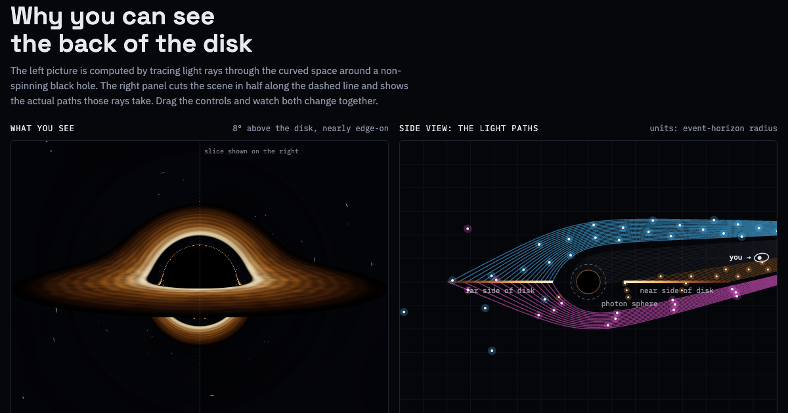

# Black Hole Light Paths

[](https://nader-eloshaiker.github.io/black-hole-light-paths/)
[](LICENSE)
[](https://github.com/nader-eloshaiker/black-hole-light-paths/deployments)

An interactive, ray-traced simulation that answers one question: **why can you see the back of a black hole's accretion disk?**

**▶ Try it: https://nader-eloshaiker.github.io/black-hole-light-paths/**



## What it shows

- **What you see (left).** Every pixel is a light ray traced backwards from your eye through the curved space around a non-spinning (Schwarzschild) black hole. It runs live on your GPU with WebGL.
- **Side view (right).** A cross-section along the centre line of the picture, showing the real paths light takes from the disk to you, with animated photons.

The light paths are colour-coded:

| Colour | Path |
| --- | --- |
| Orange | Near side of the disk, almost straight to you |
| Blue | Far side, top surface, bent **over** the hole |
| Pink | Far side, bottom surface, bent **under** the hole |
| Green | Light that wrapped around the hole (the photon ring) |
| Grey | Rays that fall in: the black shadow |

## Controls

- **Viewing angle** from 0° (exactly edge-on) to 90° (looking straight down), or press *Sweep the angle*.
- **Gravity strength** from 0% (light travels in straight lines) to 100% (real physics).
- **Colour the picture by light path** to match regions of the image to their paths.
- **Doppler brightening** to see the side of the disk moving towards you glow brighter.

## The physics

Photon paths follow the Schwarzschild orbit equation, integrated numerically as

```
x'' = -1.5 · h² · x / r⁵
```

in units of the event-horizon radius, where `h` is the photon's specific angular momentum. This reproduces the photon sphere at 1.5 horizon radii and a shadow of about 2.6 horizon radii.

Simplifications: the black hole does not spin, the disk spans 3 to 12 horizon radii and is infinitely thin, the disk colours and texture are artistic, and the Doppler option is an approximation.

## Running locally

It is a single self-contained page with no build step and no dependencies. Clone the repo and open `index.html` in any modern browser:

```bash
git clone https://github.com/nader-eloshaiker/black-hole-light-paths.git
open black-hole-light-paths/index.html
```

## Contributing

Bug reports, physics corrections and ideas are welcome. See [CONTRIBUTING.md](CONTRIBUTING.md).

## License

[MIT](LICENSE) © 2026 Nader Eloshaiker
